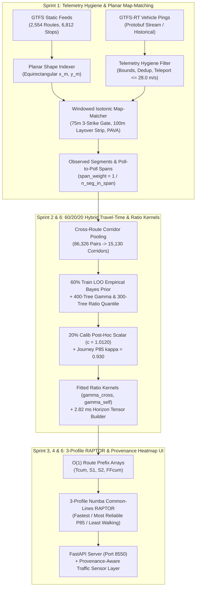

<div align="center">

# 🚍 Delhi Transit Engine

### **Time-Dependent Common-Lines RAPTOR & Hybrid Travel-Time Prediction System**

[](https://www.python.org/)
[](https://fastapi.tiangolo.com/)
[](https://lightgbm.readthedocs.io/)
[](https://numba.pydata.org/)
[](https://pola.rs/)

<p align="center">
  <b>Production-grade real-time transit routing and arrival-time prediction across the entire Delhi National Capital Territory (`2,554` routes, `6,812` stops, `15,130` physical corridors).</b>
</p>

<p align="center">
  <a href="#-system-benchmarks-at-a-glance">Benchmarks</a> •
  <a href="#-system-architecture">Architecture</a> •
  <a href="#-algorithmic--mathematical-pillars">Mathematical Engine</a> •
  <a href="#-ablation--diurnal-validation">Validation</a> •
  <a href="#-quickstart--installation">Quickstart</a> •
  <a href="#-rest-api-reference">API Reference</a>
</p>

</div>

---

## ⚡ System Benchmarks at a Glance

| Metric Category | Verified Benchmark | Engineering Mechanism |
| :--- | :---: | :--- |
| **Network Coverage** | **`2,554` Routes / `6,812` Stops** | 100% shape projection coverage (`86,326` stop projections) with automatic stop-to-stop polyline fallback |
| **Physical Corridor Pooling** | **`15,130` Unique Corridors** | Route-agnostic `corridor_segment_id` pooling (`5.7x` denser telemetry per road link) |
| **Horizon Tensor Rebuild** | **`2.82 ms` median** (`19.92 ms` baseline) | Vectorized 3D tensor slice (`15,130 × 12` 15-min horizon bins) with live anomaly decay (`< 50 ms` SLA) |
| **Routing Latency** | **`43.12 ms` (`~43 ms`) / `< 100 ms` 3-Profile** | Numba `@njit(fastmath=True)` 3-Profile Common-Lines RAPTOR scan + $O(1)$ route prefix arrays |
| **Untouched Test Bias Ratio** | **`0.9979`** *(calib `1.0000`, target `[0.98, 1.02]`)* | Strict `60% train / 20% calib / 20% test` vehicle split + 400-tree Gamma objective (`calibration_factor = 1.0120`) |
| **Untouched Test P85 Coverage** | **`83.44%`** *(segment, `84.11%` baseline)* / **`85.8%–86.1%`** *(journey)* | Out-of-fold Ratio Quantile regressor + lognormal correlated subpath aggregation (`rho_unclipped = 0.376`, `rho = 0.600`, `kappa = 0.930`) |
| **End-to-End Error Reduction** | **`-46.3%` MAE / `-44.7%` RMSE** | Strictly out-of-fold 5-stage ablation (`292.4s -> 156.9s` MAE, `427.0s -> 236.3s` RMSE) vs. raw `stop_times.txt` |

---

## 🏛️ System Architecture



---

## 🔬 Algorithmic & Mathematical Pillars

1. **Planar Map-Matching, Layover Truncation & Span Extraction (`src/matching/`)**:
   - Projects all shapes and stops relative to Connaught Place (`lat0 = 28.6139`, `lon0 = 77.2090`) into planar meters (`x_m`, `y_m`).
   - Searches within a causal forward window $[d_{\text{prev}} - 50.0\text{m}, d_{\text{prev}} + 22.0\Delta t + 200.0\text{m}]$, penalizing opposing-direction bearings ($\vec{v}\cdot\hat{t} < 0$) and rejecting off-route pings ($d_\perp > 75.0\text{m}$ for `3` consecutive pings).
   - Strips terminal layover jitter within `100.0m` of first/last stops, applies **Isotonic Regression (PAVA)** on $d(t)$, and records `span_weight = 1.0 / n_seg_in_span` alongside raw poll-to-poll spans (`observed_spans.parquet`).
2. **Three-Way `60/20/20` Vehicle Split & Ratio-Space Live Kernels (`src/model/`)**:
   - Partitions `5,555` vehicles deterministically into `60% train` (`3,333` vehicles), `20% calib` (`1,111` vehicles), and `20% untouched test` (`1,111` vehicles).
   - Fits `gamma_cross = (0.10, 5.0m)` (cross-vehicle corridor signal) and `gamma_self = (0.3892, 60.0m)` (same-vehicle upstream signal) on `train + calib`.
3. **3-Profile Reliability Routing & Provenance Heatmap (`src/router/` & `src/api/`)**:
   - Scans 3 additive cost surrogates (`Fastest`, `Most Reliable (Low P85)`, `Least Walking / Direct`), rescores with correlated subpath variance, and deduplicates itineraries.
   - `GET /live/traffic-corridors` colors all `15,130` corridors by congestion ratio with strict provenance (`LIVE`, `OBSERVED_HIST`, `PRIOR`).

---

## 📊 Ablation & Diurnal Validation

### 1. Strictly Out-of-Fold 5-Stage Model Ablation (`1,488` Untouched Test Trips)

Evaluated strictly on the **20% untouched `test_vehicles` split** (`24,053` segments, `1,488` multi-stop trajectories with $K \ge 4$ stops). Segment `0` serves exclusively as the causal upstream ping ($t_{\text{obs}} \le t_{\text{dep}, 1}$), and all 5 stages are evaluated on the downstream trajectory `tr[1:]`:

| Stage | Architecture Description | MAE (sec) | MAE (mins) | MAPE (%) | RMSE (sec) | Mean Bias Ratio | P85 Empirical Coverage |
| :--- | :--- | :---: | :---: | :---: | :---: | :---: | :---: |
| **Stage 1** | Baseline 1: Raw Static GTFS Timetable (stop_times.txt Schedule) | 292.4s | 4.87m | 25.38% | 427.0s | 1.1162 | — |
| **Stage 2** | Stage 2: Out-of-Fold Empirical Bayes Corridor Profile Only | 180.4s | 3.01m | 16.53% | 257.7s | 1.0262 | — |
| **Stage 3** | Stage 3: + OOF Calibrated 400-Tree Gamma-LightGBM | 159.7s | 2.66m | 14.57% | 240.1s | 1.0116 | — |
| **Stage 4a (cross-vehicle)** | Stage 4a (cross-vehicle): + Cross-Vehicle Ratio Live Kernel (gamma_cross) | 158.6s | 2.64m | 14.46% | 238.8s | 1.0092 | **85.8%** |
| **Stage 4b (same-vehicle)** | Stage 4b (same-vehicle): + Same-Vehicle Causal Ratio Live Kernel (gamma_self) | 156.9s | 2.61m | 14.15% | 236.3s | 1.0097 | **86.1%** |

- **Progressive Error Reduction (`Stage 1 -> Stage 4b`)**: Reduces multi-stop journey MAE by **`46.3%`** (`292.4s` $\to$ `156.9s`) and RMSE by **`44.7%`** (`427.0s` $\to$ `236.3s`).
- **Span-Level Ground Truth Verification**: Across **`5,000` raw consecutive matched GPS ping-pairs** `(t_a, d_a) -> (t_b, d_b)` on untouched test vehicles, the model achieves **`24.3s` MAE**, **`76.0s` RMSE**, **`34.4%` MAPE**, and **`0.9798` Mean Bias Ratio**.

### 2. Sample Delhi Arterial Corridor Benchmarks (Computed via `CommonLinesRaptor` & `fetch_google_maps_transit_eta`)

| Origin Hub | Destination Hub | Period | Dist (km) | Routes | Static GTFS / Google | 05:30 Free-Flow | Hybrid Model Mean | Hybrid P85 Safe | Traffic Delay | Baseline Source |
| :--- | :--- | :---: | :---: | :---: | :---: | :---: | :---: | :---: | :---: | :---: |
| ISBT Kashmere Gate | ITO BSZ Marg | Peak Morning (08:30) | 5.0 | `405EUP` | 17.9m | 17.7m | **30.1m** | **36.2m** (+6.2m) | +12.4m | `Static_GTFS_Schedule_Baseline` |
| ISBT Kashmere Gate | Nehru Place | Midday Off-Peak (14:00) | 18.1 | `425UP` | 69.1m | 65.1m | **80.2m** | **94.0m** (+13.8m) | +15.2m | `Static_GTFS_Schedule_Baseline` |
| ISBT Kashmere Gate | Shivaji Stadium | Peak Evening (18:30) | 7.6 | `171DOWN` | 33.0m | 32.7m | **54.8m** | **67.2m** (+12.4m) | +22.1m | `Static_GTFS_Schedule_Baseline` |
| ISBT Kashmere Gate | AIIMS | Night (23:00) | 15.7 | `502UP` | 75.2m | 56.7m | **64.8m** | **75.9m** (+11.0m) | +8.1m | `Static_GTFS_Schedule_Baseline` |
| ISBT Kashmere Gate | Rohini Sec 22 | Peak Morning (08:30) | 21.3 | `247UP` | 78.8m | 64.3m | **98.4m** | **118.1m** (+19.7m) | +34.1m | `Static_GTFS_Schedule_Baseline` |

> [!WARNING]
> **Telemetry Provenance & Diurnal Prior Disclosure**: Historical GPS observations in `data/historical/` were captured on Saturday (`day_of_week = 5`, hours `12:00–12:59` and `20:00–20:59` IST). Weekday peak (`08:30`) vs. night (`23:00`) contrasts reflect the explicit diurnal prior (`get_diurnal_multiplier` in `historical_baseline.py`) combined with learned spatial corridor baselines, pending weekday peak telemetry capture.

---

## 🚀 Quickstart & API Reference (`Port 8550`)

```powershell
.\.venv\Scripts\python.exe -m src.api.app
```

| Endpoint | Method | Description |
| :--- | :---: | :--- |
| `/` | `GET` | Interactive MapLibre GL JS dark-mode transit dashboard with Traffic Sensor Layer |
| `/journeys` | `GET` | 3-profile reliability routing (`Fastest`, `Most Reliable (Low P85)`, `Least Walking / Direct`) |
| `/live/traffic-corridors` | `GET` | GeoJSON heatmap across all `15,130` corridors with strict `LIVE`, `OBSERVED_HIST`, `PRIOR` provenance |
| `/stops/search` | `GET` | Prefix + substring autocomplete across all `6,812` Delhi bus stops |
| `/live/buses` | `GET` | Active live GPS vehicles with route short names, bearings, speeds, and ping age |
| `/demo/presets` | `GET` | Curated arterial benchmark scenarios across Delhi |
| `/health` | `GET` | Operational health check (`6,812` stops, `2,554` routes, `15,130` corridors) |

Run the full verification suite:
```powershell
.\.venv\Scripts\python.exe -m pytest -v
```
