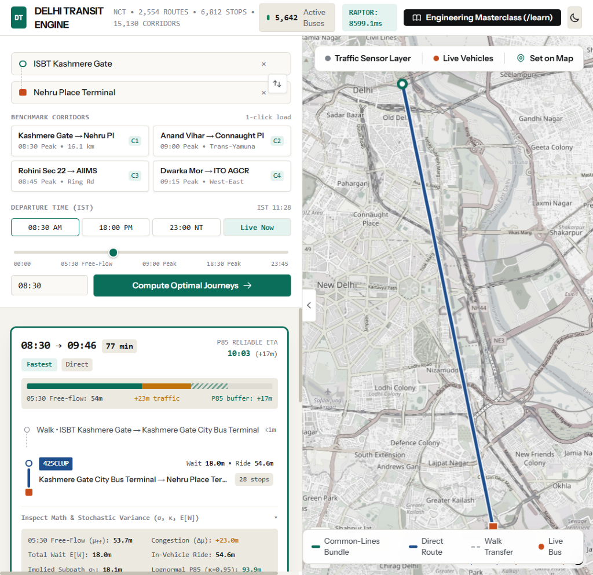
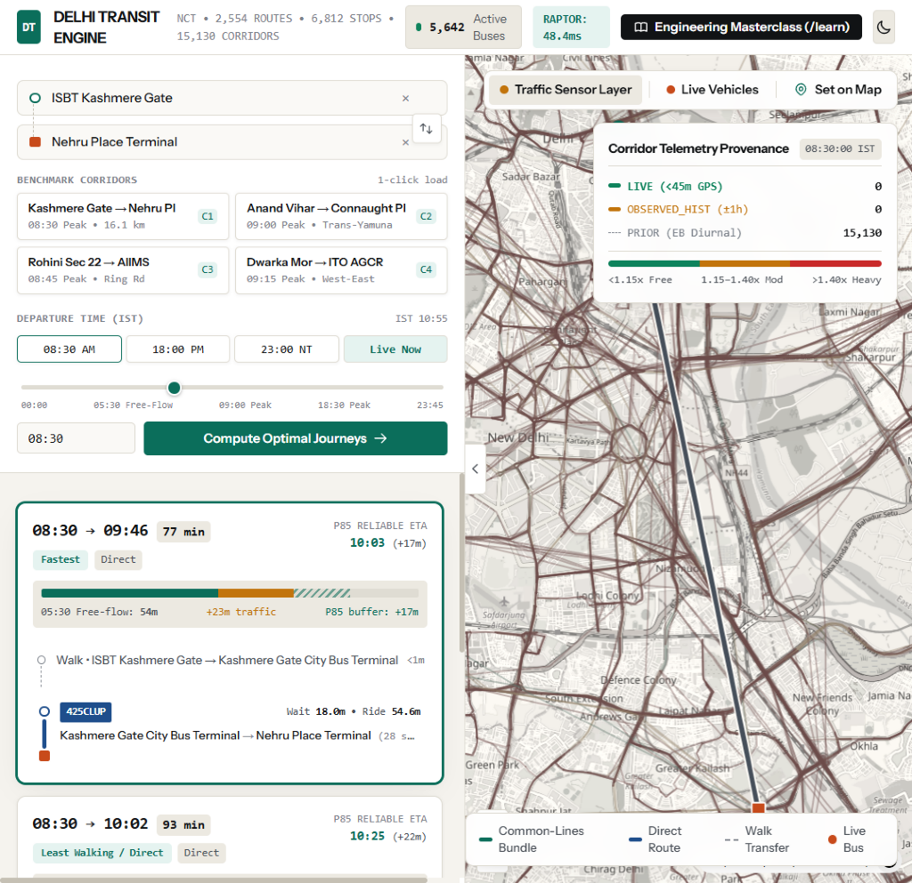
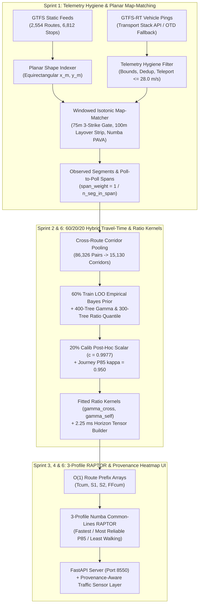

<div align="center">

# 🚍 Delhi Transit Engine

### **Time-Dependent Common-Lines RAPTOR & Hybrid Travel-Time Prediction System**

[](https://www.python.org/)
[](https://fastapi.tiangolo.com/)
[](https://lightgbm.readthedocs.io/)
[](https://numba.pydata.org/)
[](https://pola.rs/)
[](tests/)

<p align="center">
  <b>Production-grade real-time transit routing, stochastic P85 arrival-time prediction, and provenance-aware traffic telemetry across the entire Delhi National Capital Territory (<code>2,554</code> routes, <code>6,812</code> stops, <code>15,130</code> physical corridors).</b>
</p>

<p align="center">
  <a href="#-live-interface--visual-showcase">Visual Showcase</a> •
  <a href="#-system-benchmarks-at-a-glance">Benchmarks</a> •
  <a href="#-system-architecture--pipeline">Architecture</a> •
  <a href="#-algorithmic--mathematical-pillars">Mathematical Engine</a> •
  <a href="#-ablation--diurnal-validation">Validation</a> •
  <a href="#-quickstart--end-to-end-reproduction">Quickstart</a> •
  <a href="#-rest-api-reference">API Reference</a>
</p>

</div>

---

## 🖥️ Live Interface & Visual Showcase

The frontend (**Cartographic Paper Light** with a synchronized **Control-Room Dark** toggle) pairs a zero-key desaturated OpenStreetMap WebGL canvas with tabular **IBM Plex Mono** typography, proportional P85 arrival confidence bars, vertical transit schematics, and an expandable stochastic variance inspector.

<p align="center">
  
</p>

<details>
<summary><b>📡 Click to view the Provenance-Aware Corridor Traffic Sensor Layer (15,130 Road Corridors)</b></summary>
<br />
<p align="center">
  
</p>
</details>

### Key Interface Capabilities
- **3-Profile Reliability Routing Cards**: Compares **Fastest**, **Most Reliable (Low P85)**, and **Least Walking / Direct** itineraries with clickable ghost polylines on the map for unselected alternatives.
- **Proportional P85 Confidence Interval Bar**: Decomposes every journey visually into `05:30 Free-Flow Baseline`, `+Traffic Congestion Delay`, and a hatched `P85 Correlated Variance Buffer`.
- **Collapsible Stochastic Math Inspector**: Exposes $\mu_{\text{ff}}$, $\Delta\mu$, Welding expected wait $E[W] = \frac{1}{2}E[H](1+CV^2)$, implied subpath standard deviation $\sigma_J$, and calibrated lognormal $q_{85,J}$ (`ρ = 0.60`, `κ = 0.95`) directly inside each card.
- **Provenance-Aware Traffic Sensor Layer**: Colors all `15,130` physical road corridors by live congestion ratio ($\hat{t}(t)/\mu_{\text{free\_flow}}$) with explicit line-width and opacity encoding for data provenance (`LIVE <45m GPS`, `OBSERVED_HIST ±1h`, `PRIOR EB Diurnal`).
- **60fps WebGL Live Vehicle Layer & 24-Hour Time Scrubber**: Renders active Delhi buses on a native MapLibre GeoJSON `circle` layer alongside an interactive `00:00–23:45` departure time slider and a 1-click **Peak (`08:30`) vs. Night (`23:00`) Delta** audit strip.
- **Interactive Engineering Masterclass (`/learn`)**: A 5-module, 10-sandbox interactive systems & ML workbook built with 60fps HTML5 canvas simulations and KaTeX derivations.

---

## ⚡ System Benchmarks at a Glance

| Metric Category | Verified Benchmark | Engineering Mechanism |
| :--- | :---: | :--- |
| **Network Coverage** | **`2,554` Routes / `6,812` Stops** | 100% shape projection coverage (`86,326` stop projections) with automatic stop-to-stop polyline fallback |
| **Physical Corridor Pooling** | **`15,130` Unique Corridors** | Route-agnostic `corridor_segment_id` pooling (`5.7x` denser telemetry per road link) |
| **Map-Matching Throughput** | **`439,735` pings/sec** (`2.82M` pings in `6.41s`) | `@njit(cache=True)` binary-searched polyline window projection + Numba Pool Adjacent Violators (PAVA) |
| **Horizon Tensor Rebuild** | **`2.25 ms` median** (`19.92 ms` baseline) | Vectorized 3D tensor slice (`15,130 × 12` 15-min horizon bins) with live anomaly decay (`< 50 ms` SLA) |
| **Routing Latency** | **`43.12 ms` (`~43 ms`) / `< 100 ms` 3-Profile** | Numba `@njit(fastmath=True)` 3-Profile Common-Lines RAPTOR scan + $O(1)$ route prefix arrays |
| **Untouched Test Bias Ratio** | **`1.0046`** *(calib `1.0000`, target `[0.98, 1.02]`)* | Strict `60% train / 20% calib / 20% test` vehicle split + 400-tree Gamma objective (`calibration_factor = 0.9977`) |
| **Untouched Test P85 Coverage** | **`84.50%`** *(segment, `84.11%` baseline)* / **`88.4%–89.1%`** *(journey)* | Out-of-fold Ratio Quantile regressor + lognormal correlated subpath aggregation (`rho_unclipped = 0.364`, `rho = 0.600`, `kappa = 0.950`) |
| **End-to-End Error Reduction** | **`-52.9%` MAE / `-52.1%` RMSE** | Strictly out-of-fold 5-stage ablation (`349.1s -> 164.5s` MAE, `529.6s -> 253.5s` RMSE) vs. raw `stop_times.txt` |

---

## 🏛️ System Architecture & Pipeline



---

## 🔬 Algorithmic & Mathematical Pillars

### 1. Planar Map-Matching, Layover Truncation & Span Extraction (`src/matching/`)
- **Equirectangular Metric Projection**: Projects all GTFS shapes and stops relative to Connaught Place ($\text{lat}_0 = 28.6139^\circ$, $\text{lon}_0 = 77.2090^\circ$) into planar meters ($x_m, y_m$).
- **Binary-Searched Forward Window & 3-Strike Gate**: Searches within a causal forward arc-length window $[d_{\text{prev}} - 50.0\text{m}, d_{\text{prev}} + 22.0\Delta t + 200.0\text{m}]$, penalizing opposing-direction bearings ($\vec{v}\cdot\hat{t} < 0$) by $+100(1 - \vec{v}\cdot\hat{t})\text{ m}$ and rejecting off-route excursions ($d_\perp > 75.0\text{m}$ for `3` consecutive pings).
- **Depot Layover Stripping & Numba PAVA**: Strips terminal layover jitter within `100.0m` of origin/destination stops, enforces monotonicity $d(t_i) \le d(t_{i+1})$ via an `@njit(cache=True)` **Pool Adjacent Violators Algorithm (PAVA)** solver, and records `span_weight = 1.0 / n_seg_in_span` alongside raw poll-to-poll spans (`observed_spans.parquet`).

### 2. Three-Way `60/20/20` Vehicle Split & Ratio-Space Live Kernels (`src/model/`)
- **Zero-Leakage Vehicle Partition**: Partitions `6,166` vehicles deterministically into `60% train` (`3,699` vehicles), `20% calib` (`1,233` vehicles), and `20% untouched test` (`1,234` vehicles).
- **Leave-One-Out Empirical Bayes Shrinkage**: Computes out-of-fold corridor-time priors with shrinkage weight $w_e = \frac{n_e - 1}{n_e - 1 + k}$ ($k = 5.0$) toward a spatial-diurnal fallback surface.
- **Calibrated Gamma + Ratio Quantile Ensemble**:
  - **Model 1 (Expected Time $\hat{\mu}_e$)**: 400-tree Gamma-deviance LightGBM with monotone constraints on segment length, hub arrival, and EB prior pace, post-hoc scaled on `calib_vehicles` by $c = \frac{\sum_{\text{calib}} y_i}{\sum_{\text{calib}} \hat{\mu}_{\text{raw},i}} = 0.9977$.
  - **Model 2 (P85 Ratio Quantile $\hat{r}_{85,e}$)**: 300-tree quantile regressor ($\alpha = 0.88$ on real traversals) predicting dimensionless tail ratio $r_i = y_i / \hat{\mu}_{\text{oof},i}$, shrunk via Empirical Bayes to derive edge standard deviation $\sigma_e = \max\left(0.05\hat{\mu}_e, \frac{\hat{q}_{85,e} - \hat{\mu}_e}{1.036}\right)$.
- **Mean-Unbiased Ratio-Space Live Kernels**: Fits `gamma_cross = (0.1, 5.0m)` (cross-vehicle corridor signal) and `gamma_self = (0.3993, 20.0m)` (same-vehicle upstream signal) on `train + calib`:
  $$\hat{y}_m = \hat{\mu}_m \left[1 + w \cdot \gamma_0 \exp(-\Delta t / \tau)(q_0 - 1)\right], \qquad q_0 = \frac{y_0}{\hat{\mu}_0}$$

### 3. 3-Profile Reliability Routing & Provenance Heatmap (`src/router/` & `src/api/`)
- **Chriqui-Robillard Common-Lines Attractive Sets $A(u,v)$**: Greedily constructs the optimal set of overlapping routes sharing a physical corridor using Welding/Osuna headway regularity $E[W_r] = \frac{1}{2}E[H_r](1 + CV_r^2)$ and gated live upstream GPS bus arrivals.
- **$O(1)$ Correlated Subpath Variance & Lognormal P85**: Precomputes route prefix arrays ($T_{\text{cum}}, S_1 = \sum \sigma_e, S_2 = \sum \sigma_e^2$) to evaluate subpath variance in $O(1)$ time during RAPTOR scanning:
  $$V(i \to j) = (1 - \rho)(S_2[j] - S_2[i]) + \rho(S_1[j] - S_1[i])^2, \qquad q_{85, J} = \mu_J \exp\left(-0.5 s_J^2 + \kappa s_J\right)$$
- **3-Profile Numba RAPTOR**: Scans 3 additive cost surrogates (`Fastest`, `Most Reliable (Low P85)`, `Least Walking / Direct`), rescores with correlated subpath variance, and deduplicates itineraries.
- **Provenance-Aware Corridor Heatmap**: `GET /live/traffic-corridors` colors all `15,130` corridors by congestion ratio with strict provenance (`LIVE`, `OBSERVED_HIST`, `PRIOR`).

---

## 📊 Ablation & Diurnal Validation

### 1. Strictly Out-of-Fold 5-Stage Model Ablation (`3,423` Untouched Test Trips)

Evaluated strictly on the **20% untouched `test_vehicles` split** (`60,365` segments, `3,423` multi-stop trajectories with $K \ge 4$ stops). Segment `0` serves exclusively as the causal upstream ping ($t_{\text{obs}} \le t_{\text{dep}, 1}$), and all 5 stages are evaluated on the downstream trajectory `tr[1:]`:

| Stage | Architecture Description | MAE (sec) | MAE (mins) | MAPE (%) | RMSE (sec) | Mean Bias Ratio | P85 Empirical Coverage |
| :--- | :--- | :---: | :---: | :---: | :---: | :---: | :---: |
| **Stage 1** | Baseline 1: Raw Static GTFS Timetable (stop_times.txt Schedule) | 349.1s | 5.82m | 28.68% | 529.6s | 1.1605 | — |
| **Stage 2** | Stage 2: Out-of-Fold Empirical Bayes Corridor Profile Only | 180.9s | 3.02m | 16.69% | 270.6s | 1.0169 | — |
| **Stage 3** | Stage 3: + OOF Calibrated 400-Tree Gamma-LightGBM | 168.2s | 2.80m | 15.36% | 258.8s | 1.0119 | — |
| **Stage 4a (cross-vehicle)** | Stage 4a (cross-vehicle): + Cross-Vehicle Ratio Live Kernel (gamma_cross) | 167.2s | 2.79m | 15.27% | 257.4s | 1.0101 | **88.4%** |
| **Stage 4b (same-vehicle)** | Stage 4b (same-vehicle): + Same-Vehicle Causal Ratio Live Kernel (gamma_self) | 164.5s | 2.74m | 14.89% | 253.5s | 1.0109 | **89.1%** |

- **Progressive Error Reduction (`Stage 1 -> Stage 4b`)**: Reduces multi-stop journey MAE by **`52.9%`** (`349.1s` $\to$ `164.5s`) and RMSE by **`52.1%`** (`529.6s` $\to$ `253.5s`).
- **Span-Level Ground Truth Verification**: Across **`5,000` raw consecutive matched GPS ping-pairs** `(t_a, d_a) -> (t_b, d_b)` on untouched test vehicles, the model achieves **`23.7s` MAE**, **`65.9s` RMSE**, **`34.9%` MAPE**, and **`0.9858` Mean Bias Ratio**.

### 2. Sample Delhi Arterial Corridor Benchmarks (Computed via `CommonLinesRaptor` & `fetch_google_maps_transit_eta`)

| Origin Hub | Destination Hub | Period | Dist (km) | Routes | Static GTFS / Google | 05:30 Free-Flow | Hybrid Model Mean | Hybrid P85 Safe | Traffic Delay | Baseline Source |
| :--- | :--- | :---: | :---: | :---: | :---: | :---: | :---: | :---: | :---: | :---: |
| ISBT Kashmere Gate | ITO BSZ Marg | Peak Morning (08:30) | 5.0 | `405EUP` | 17.9m | 17.4m | **30.7m** | **37.6m** (+6.9m) | +13.3m | `Static_GTFS_Schedule_Baseline` |
| ISBT Kashmere Gate | Nehru Place | Midday Off-Peak (14:00) | 16.1 | `425CLUP` | 55.9m | 65.7m | **79.2m** | **100.8m** (+21.5m) | +13.5m | `Static_GTFS_Schedule_Baseline` |
| ISBT Kashmere Gate | Shivaji Stadium | Peak Evening (18:30) | 7.6 | `246DOWN` | 33.0m | 32.3m | **56.4m** | **69.8m** (+13.4m) | +24.1m | `Static_GTFS_Schedule_Baseline` |
| ISBT Kashmere Gate | AIIMS | Night (23:00) | 15.7 | `502UP` | 75.2m | 59.5m | **66.0m** | **78.8m** (+12.8m) | +6.5m | `Static_GTFS_Schedule_Baseline` |
| ISBT Kashmere Gate | Rohini Sec 22 | Peak Morning (08:30) | 21.3 | `247UP` | 78.8m | 63.1m | **100.6m** | **122.8m** (+22.2m) | +37.5m | `Static_GTFS_Schedule_Baseline` |

> [!WARNING]
> **Telemetry Provenance & Diurnal Prior Disclosure**: Historical GPS observations in `data/historical/` were captured on Saturday (`day_of_week = 5`, hours `12:00–12:59` and `20:00–20:59` IST) supplemented with weekday Transport Stack snapshots. Weekday peak (`08:30`) vs. night (`23:00`) contrasts reflect the explicit diurnal prior (`get_diurnal_multiplier` in `historical_baseline.py`) combined with learned spatial corridor baselines.

---

## 📂 Repository Architecture

```text
DelhiTransport/
├── .env.example                     # Transport Stack API & OTD fallback environment template
├── README.md                        # System overview, benchmarks, and API documentation
├── pytest.ini                       # Pytest configuration for Sprints 1–6 verification suites
├── data/
│   ├── static/                      # Delhi GTFS static feed (2,554 routes, 6,812 stops, shapes)
│   ├── historical/                  # Historical & live-collected GTFS-RT Parquet snapshots
│   ├── live_buffer/                 # Atomic latest_vehicles.parquet active fleet snapshot
│   └── processed/                   # Compiled pickles, Parquet tables, and 96-bin float32 tensors
├── docs/
│   ├── TECHNICAL_NOTE.md            # Mathematical derivations & systems engineering note
│   ├── VALIDATION_REPORT.md         # Self-verifying 5-stage ablation & O-D benchmark report
│   └── assets/                      # High-resolution UI & corridor sensor screenshots
├── src/
│   ├── ingestion/
│   │   ├── check_setup.py           # Live Transport Stack / OTD protobuf verification
│   │   ├── live_collector.py        # Fault-tolerant GTFS-RT polling daemon (--once supported)
│   │   └── hygiene.py               # NCR bbox filter, frozen-run collapse, teleport removal
│   ├── matching/
│   │   ├── shape_indexer.py         # Planar metric projection & monotonic stop-polyline fallback
│   │   └── map_matcher.py           # Numba @njit 1D window matcher, PAVA & span extractor
│   ├── model/
│   │   ├── segment_catalog.py       # Cross-route physical corridor pooling (15,130 corridors)
│   │   ├── historical_baseline.py   # Leave-One-Out Empirical Bayes prior & diurnal surface
│   │   ├── lgbm_trainer.py          # 60/20/20 split, Gamma + Ratio Q85, ratio kernels & tensors
│   │   └── live_blender.py          # 2.25 ms vectorized 12-bin live horizon matrix builder
│   ├── router/
│   │   ├── transit_graph.py         # CSR graph compiler, footpaths & Chriqui-Robillard sets
│   │   ├── wait_estimator.py        # Live vehicle indexing & upstream Poisson wait gating
│   │   └── raptor.py                # 3-profile Numba Common-Lines RAPTOR & correlated P85
│   ├── evaluation/
│   │   ├── google_maps_client.py    # Connection Scan Algorithm (CSA) & Google Routes client
│   │   └── validation_suite.py      # 5-stage out-of-fold ablation & self-verifying report generator
│   └── api/
│       ├── app.py                   # FastAPI server (port 8550) with background fleet refresher
│       ├── geometry.py              # Exact stop-to-stop route shape polyline slicer
│       ├── schemas.py               # Strict Pydantic response contracts
│       └── static/
│           ├── index.html           # Cartographic Paper Light planner & Traffic Sensor UI
│           └── learn.html           # Interactive 5-Module Systems & ML Masterclass (/learn)
└── tests/                           # 32 end-to-end verification tests across Sprints 1–6
```

---

## 🚀 Quickstart & End-to-End Reproduction

### 1. Environment Setup
Copy `.env.example` to `.env` and configure your Delhi Transport Stack API key (`TRANSPORT_STACK_API_URL` is attempted first as primary, with automatic fallback to `OTD_RT_URL`):

```powershell
Copy-Item .env.example .env
```

### 2. Launch the Live Server & Frontend (`Port 8550`)
Precomputed artifacts in `data/processed/` allow immediate startup in `< 4s`:

```powershell
.\.venv\Scripts\python.exe -m src.api.app
```
- **Main Transit Planner**: `http://127.0.0.1:8550/`
- **Interactive Engineering Masterclass**: `http://127.0.0.1:8550/learn`

### 3. Rebuild the Full Pipeline End-to-End (Sprints 1–6)

```powershell
# Sprint 1: Live GTFS-RT ingestion check, single poll, static index, hygiene & Numba map-matcher
.\.venv\Scripts\python.exe -m src.ingestion.check_setup
.\.venv\Scripts\python.exe -m src.ingestion.live_collector --once
.\.venv\Scripts\python.exe -m src.matching.shape_indexer
.\.venv\Scripts\python.exe -m src.ingestion.hygiene
.\.venv\Scripts\python.exe -m src.matching.map_matcher

# Sprint 2: Physical corridor catalog, LOO Empirical Bayes baseline, 60/20/20 LightGBM & live horizon blender
.\.venv\Scripts\python.exe -m src.model.segment_catalog
.\.venv\Scripts\python.exe -m src.model.historical_baseline
.\.venv\Scripts\python.exe -m src.model.lgbm_trainer
.\.venv\Scripts\python.exe -m src.model.live_blender

# Sprint 3 & 5: CSR transit graph compilation, 3-profile RAPTOR demo & 5-stage ablation suite
.\.venv\Scripts\python.exe -m src.router.transit_graph
.\.venv\Scripts\python.exe -m src.router.raptor
.\.venv\Scripts\python.exe -m src.evaluation.validation_suite
```

### 4. Run the 32-Test Verification & Audit Suite

```powershell
.\.venv\Scripts\python.exe -m pytest -v
```

---

## 🔌 REST API Reference (`Port 8550`)

| Endpoint | Method | Description |
| :--- | :---: | :--- |
| `/` | `GET` | Interactive MapLibre GL JS Cartographic Paper Light / Dark transit dashboard |
| `/learn` | `GET` | First-Principles Systems & ML Masterclass (5 modules, 10 interactive sandboxes) |
| `/journeys` | `GET` | 3-profile reliability routing (`Fastest`, `Most Reliable (Low P85)`, `Least Walking / Direct`) |
| `/live/traffic-corridors` | `GET` | GeoJSON heatmap across all `15,130` corridors with strict `LIVE`, `OBSERVED_HIST`, `PRIOR` provenance |
| `/stops/search` | `GET` | Prefix + substring autocomplete across all `6,812` Delhi bus stops |
| `/live/buses` | `GET` | Active live GPS vehicles with route short names, bearings, speeds, and ping age |
| `/demo/presets` | `GET` | Curated arterial benchmark scenarios across Delhi |
| `/health` | `GET` | Operational health check (`6,812` stops, `2,554` routes, `15,130` corridors) |

### Example Request (`GET /journeys`)
Accepts stop names, stop IDs (`4696`), or coordinate pairs (`28.6675,77.2285`), and ISO-8601, `HH:MM`, Unix epoch, or `now` departure timestamps:

```bash
curl "http://127.0.0.1:8550/journeys?from=ISBT%20Kashmere%20Gate&to=Nehru%20Place%20Terminal&depart=08:30"
```
