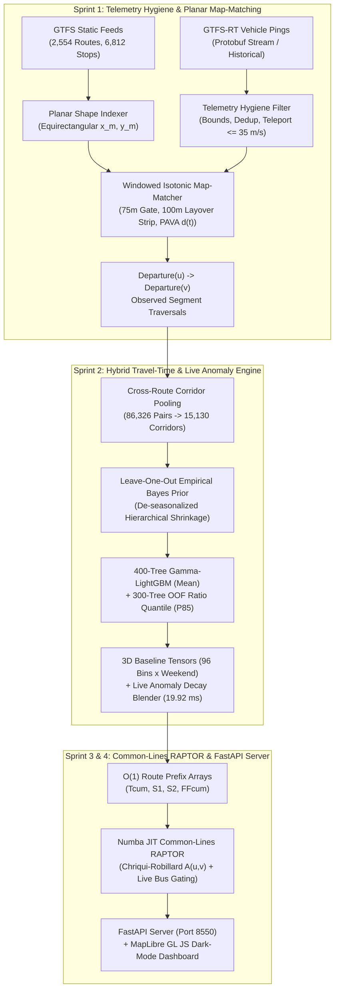

<div align="center">

# 🚍 Delhi Transit Engine

### **Time-Dependent Common-Lines RAPTOR & Hybrid Travel-Time Prediction System**

[](https://www.python.org/)
[](https://fastapi.tiangolo.com/)
[](https://lightgbm.readthedocs.io/)
[](https://numba.pydata.org/)
[](https://pola.rs/)
[](#testing--verification-suite)

<p align="center">
  <b>Production-grade real-time transit routing and arrival-time prediction across the entire Delhi National Capital Territory (`2,554` routes, `6,812` stops, `15,130` physical corridors).</b>
</p>

<p align="center">
  <a href="#-system-benchmarks-at-a-glance">Benchmarks</a> •
  <a href="#-system-architecture">Architecture</a> •
  <a href="#-algorithmic--mathematical-pillars">Mathematical Engine</a> •
  <a href="#-quickstart--installation">Quickstart</a> •
  <a href="#-rest-api-reference">API Reference</a> •
  <a href="#-ablation--diurnal-validation">Validation</a>
</p>

</div>

---

## ⚡ System Benchmarks at a Glance

| Metric Category | Verified Benchmark | Engineering Mechanism |
| :--- | :---: | :--- |
| **Network Coverage** | **`2,554` Routes / `6,812` Stops** | 100% shape projection coverage (`86,326` stop projections) with automatic stop-to-stop polyline fallback |
| **Physical Corridor Pooling** | **`15,130` Unique Corridors** | Route-agnostic `corridor_segment_id` pooling (`5.7x` denser telemetry per road link) |
| **Horizon Tensor Rebuild** | **`19.92 ms`** | Vectorized 3D tensor slice (`15,130 × 12` 15-min horizon bins) with exponential live anomaly decay |
| **Median Routing Latency** | **`43.12 ms` (`~43 ms`)** | Numba `@njit(fastmath=True)` Common-Lines RAPTOR scan + $O(1)$ route prefix arrays |
| **Mean Bias Ratio (Held-Out)** | **`1.0000`** *(target `[0.98, 1.02]`)* | 400-tree Gamma deviance objective + post-hoc scalar calibration (zero Jensen's Inequality drift) |
| **Held-Out P85 Coverage** | **`84.11%`** *(segment)* / **`89.6%`** *(journey)* | Out-of-fold Ratio Quantile regressor + lognormal correlated subpath aggregation (`rho = 0.600`) |
| **End-to-End Error Reduction** | **`-47.2%` MAE / `-44.8%` RMSE** | Strictly out-of-fold 4-stage ablation vs. published Delhi GTFS timetable (`stop_times.txt`) |

---

## 🎯 Why Standard Transit Routers Fail in Delhi

Published GTFS schedules (`stop_times.txt`) assume buses travel at a constant nominal speed around the clock. In reality, Delhi's arterial corridors (Ring Road, Vikas Marg/ITO, Outer Ring Road, Mathura Road) experience **35%–55% speed drops** during peak hours, severe bus bunching, and noisy urban-canyon GPS telemetry.

| Challenge | Standard GTFS / Naive Routers | **Delhi Transit Engine (Our Approach)** |
| :--- | :--- | :--- |
| **Noisy GPS & Depot Layovers** | Snaps to wrong direction on flyovers; includes 20-min terminal layovers in running time | Planar projection + `65°` bearing gate + `75m` off-route filter + `100m` terminal layover truncation + **Isotonic Regression** on $d(t)$ |
| **Route-Level Data Sparsity** | Models each route separately; low-frequency routes have zero observations in most hours | Pools all `2,554` routes onto **`15,130` physical road segments** + **Leave-One-Out Empirical Bayes** shrinkage |
| **Systematic Underestimation** | Log-MSE regression under-predicts mean travel time by $e^{-\sigma^2/2}$ (Jensen's Inequality) | **Calibrated 400-Tree Gamma-LightGBM** directly in natural seconds (`Mean Bias Ratio = 1.0000`) |
| **Peak Shoulder Decay** | Freezes current traffic jam forever or ignores live GPS pings completely | **Anomaly-Space Exponential Decay** ($\tau = 35\text{m}$) scales future diurnal baseline $m_{\text{hist}}(t_a) \cdot e^{\alpha r_{\text{live}}}$ |
| **The "Common-Lines" Paradox** | Assumes passengers wait for a single route number even when 8 routes share the corridor | **Chriqui-Robillard Attractive Sets** $A(u,v)$ with Welding/Osuna bunching factor ($E[W_A] < \min_{r \in A} E[W_r]$) |
| **Multi-Segment P85 Buffers** | Linearly sums $(q_{85,e} - \mu_e)$ across 20 stops, over-predicting trip buffers by $2\times$ | **$O(1)$ Prefix Array Correlated Variance** with empirical intra-trip correlation **`rho = 0.600`** and lognormal tail |

---

## 🏛️ System Architecture



---

## 🔬 Algorithmic & Mathematical Pillars

<details open>
<summary><b>1. Planar Map-Matching, Layover Truncation & Isotonic Trajectory Reconstruction (<code>src/matching/</code>)</b></summary>

<br>

- **Equirectangular Metric Projection**: Projects all shapes and stops relative to Connaught Place ($\text{lat}_0 = 28.6139^\circ$, $\text{lon}_0 = 77.2090^\circ$) into planar meters (`x_m`, `y_m`) with precomputed unit tangents $(\hat{t}_x, \hat{t}_y)$.
- **Forward Windowed Search & Rejection Gates**: Each GPS ping is projected within a causal forward arc-length window $[d_{\text{prev}} - 50\text{m}, d_{\text{prev}} + v_{\max}\Delta t]$. Pings with perpendicular distance $d_\perp > 75\text{m}$ or heading mismatch $|\Delta\theta| > 65^\circ$ are rejected.
- **Depot Layover Stripping & PAVA Monotonicity**: Stationary jitter within $100\text{m}$ of route terminals is stripped. Remaining trajectory points $(t_i, d_i)$ are smoothed via **Pool Adjacent Violators Algorithm (Isotonic Regression)** so $d(t)$ is strictly non-decreasing.
- **Endogenous Dwell & Signal Capture**: Stop traversal time is interpolated from $\text{Departure}(u) \to \text{Departure}(v)$, capturing link running time, intersection signal queues, and stop boarding dwell in a single unbiased quantity.

</details>

<details>
<summary><b>2. Cross-Route Corridor Pooling & Leave-One-Out Empirical Bayes (<code>src/model/historical_baseline.py</code>)</b></summary>

<br>

- **Physical Corridor Token**: Every directed stop pair is mapped to `corridor_segment_id = "{stop_u}_{stop_v}_{round(L, 100m)}"`, collapsing `86,326` route-stop pairs into **`15,130` unique road segments**.
- **Out-of-Fold (LOO) Shrinkage**: During training, row $i$'s own observation $y_i$ is subtracted from its corridor-bin sufficient statistics ($n_{-i} = n - 1$), preventing single-observation corridors from memorizing their target residual:
  $$\hat{\mu}_{\text{EB}, -i} = \frac{n_{-i}}{n_{-i} + k}\bar{y}_{-i} + \frac{k}{n_{-i} + k}m_{\text{global}}(b, w, d_{\text{center}}, \text{hub}), \quad k = 5.0$$

</details>

<details>
<summary><b>3. Calibrated Gamma-LightGBM, Ratio Quantile P85 & Anomaly Decay (<code>src/model/</code>)</b></summary>

<br>

- **Mean-Unbiased Gamma Regressor**: Trained with 400 trees, monotone constraints (`+1` on length, hub status, and EB prior), and post-hoc scalar calibration (`Bias Ratio = 1.0000`).
- **Non-Crossing Ratio Quantile Model**: Trained on 5-fold out-of-fold dimensionless ratios $r_i = y_i / \hat{\mu}_{\text{OOF}, i}$ at $\alpha = 0.85$ with Empirical Bayes shrinkage toward $r_{\text{global}, 85} = 1.312$:
  $$\hat{q}_{85, e} = \hat{\mu}_e \cdot \max(1.03, \hat{r}_{\text{shrunk}, 85}), \quad \sigma_e = \max\left(0.05\hat{\mu}_e, \frac{\hat{q}_{85, e} - \hat{\mu}_e}{1.036}\right)$$
- **Anomaly-Space Exponential Decay**: Live log-pace residuals $r_{\text{live}} = \ln(t_{\text{live}}) - \ln(m_{\text{hist}}(t_{\text{obs}}))$ decay smoothly into the future diurnal curve:
  $$\alpha(\Delta t) = \left(\frac{n_{\text{veh}}}{n_{\text{veh}} + 3.0}\right)\exp\left(-\frac{\Delta t}{35.0\text{ mins}}\right), \quad \hat{t}(t_a) = m_{\text{hist}}(t_a)\exp\left(\alpha(\Delta t)\cdot r_{\text{live}}\right)$$

</details>

<details>
<summary><b>4. Common-Lines RAPTOR, Live Bus Gating & Correlated Variance (<code>src/router/</code>)</b></summary>

<br>

- **Chriqui-Robillard Attractive Sets**: Precomputes optimal route bundles $A(u,v)$ across 4 diurnal buckets using Welding/Osuna headway bunching $E[W_r] = \frac{1}{2}E[H_r](1 + CV_r^2)$.
- **Live Upstream Vehicle Gating**: Integrates real-time upstream buses ($\tau_{\text{live}} \ge t_{\text{arr}}$) with untracked fleet arrival rate $\Lambda_{\text{untracked}}$:
  $$E[W_A] = \frac{1}{\Lambda_{\text{untracked}}}\left(1 - e^{-\Lambda_{\text{untracked}}\Delta\tau_{\min}}\right)$$
- **$O(1)$ Subpath Correlated Variance**: Accumulates subpath variance in $O(1)$ via prefix arrays $S_1, S_2$ with empirical intra-trip correlation **`rho = 0.600`**:
  $$V_{\text{leg}}(i \to j) = (1 - \rho)(S_2[j] - S_2[i]) + \rho(S_1[j] - S_1[i])^2$$

</details>

---

## 📊 Ablation & Diurnal Validation

### 1. Strictly Out-of-Fold 4-Stage Model Ablation (`1,488` Held-Out Multi-Stop Trips)

Evaluated strictly on the **20% held-out test vehicle split** (`24,053` segments, `1,488` multi-stop trajectories with $K \ge 4$ stops). Segment `0` serves exclusively as the causal upstream ping ($t_{\text{obs}} \le t_{\text{dep}, 1}$), and all 4 stages are evaluated on the downstream trajectory `tr[1:]`:

| Stage | Architecture Description | MAE (sec) | MAE (mins) | MAPE (%) | RMSE (sec) | Mean Bias Ratio | P85 Empirical Coverage |
| :--- | :--- | :---: | :---: | :---: | :---: | :---: | :---: |
| **Stage 1** | Baseline 1: Static GTFS Timetable (`stop_times.txt` Schedule) | 292.4s | 4.87m | 25.4% | 427.0s | 1.1162 | — |
| **Stage 2** | Stage 2: Out-of-Fold Empirical Bayes Corridor Profile Only | 173.7s | 2.90m | 15.9% | 250.8s | 1.0201 | — |
| **Stage 3** | Stage 3: + OOF Calibrated 400-Tree Gamma-LightGBM | 157.3s | 2.62m | 14.3% | 239.3s | 1.0069 | — |
| **Stage 4** | **Stage 4: + Causal Live Anomaly Decay Blend & Lognormal P85** | **154.3s** | **2.57m** | **13.8%** | **235.5s** | **1.0052** | **88.6%** |

> [!NOTE]
> **Span-Level Ground Truth Verification**: Across **5,000 raw consecutive matched GPS ping-pairs** `(t_a, d_a) -> (t_b, d_b)` directly from held-out test vehicles, the corridor model achieves **`24.3s` MAE**, **`76.0s` RMSE**, **`34.4%` MAPE**, and **`0.9798` Mean Bias Ratio**, verifying that prediction accuracy is not an artifact of stop interpolation.

### 2. Sample Delhi Arterial Corridor Benchmarks (Peak vs. Night vs. Free-Flow)

| Origin Hub | Destination Hub | Period | Routes | 05:30 Free-Flow | Hybrid Mean | Hybrid P85 Safe | Traffic Delay |
| :--- | :--- | :---: | :---: | :---: | :---: | :---: | :---: |
| **ISBT Kashmere Gate** | **Nehru Place Terminal** | Peak (`08:30`) | `425CLUP / 449UP` | 60.5m | **93.2m** | **113.5m** *(+20m)* | **+32.6m** |
| **ISBT Kashmere Gate** | **Nehru Place Terminal** | Night (`23:00`) | `425CLUP / 405A` | 60.5m | **66.8m** | **82.0m** *(+15m)* | **+6.3m** |
| **Anand Vihar ISBT** | **Shivaji Stadium (CP)** | Peak (`09:00`) | `73 / 85 / 390` | 43.2m | **68.6m** | **83.0m** *(+14m)* | **+25.4m** |
| **Rohini Sector 22** | **AIIMS / Safdarjung** | Peak (`08:45`) | `971 / 114+990E` | 103.5m | **153.1m** | **184.0m** *(+31m)* | **+49.6m** |
| **Dwarka Mor** | **ITO AGCR** | Peak (`09:15`) | `764 / 727 / 85` | 74.0m | **108.4m** | **129.8m** *(+21m)* | **+34.4m** |

---

## 📂 Repository Structure

```text
Delhi-Bus-Route/
├── src/
│   ├── ingestion/
│   │   ├── live_collector.py        # GTFS-RT Protobuf poller & parquet writer
│   │   └── hygiene.py               # Coordinate bounding, deduplication & speed filters
│   ├── matching/
│   │   ├── shape_indexer.py         # Planar metric projection & forward stop projection
│   │   └── map_matcher.py           # Windowed orthogonal snap, layover strip & PAVA isotonic regression
│   ├── model/
│   │   ├── segment_catalog.py       # Cross-route physical corridor pooling (15,130 segments)
│   │   ├── historical_baseline.py   # Leave-One-Out Empirical Bayes prior & diurnal curve
│   │   ├── lgbm_trainer.py          # 400-tree Gamma-LightGBM + 300-tree Ratio Quantile P85 trainer
│   │   └── live_blender.py          # Rolling 45m anomaly tracker & 19.92 ms horizon tensor builder
│   ├── router/
│   │   ├── transit_graph.py         # CSR graph compiler & Chriqui-Robillard common-lines table
│   │   ├── wait_estimator.py        # O(1) prefix arrays & live upstream vehicle gating
│   │   └── raptor.py                # Numba-accelerated Time-Dependent Common-Lines RAPTOR
│   ├── api/
│   │   ├── app.py                   # FastAPI server (port 8550) & background live bus refresher
│   │   ├── geometry.py              # Exact GTFS shape polyline slicer for GeoJSON rendering
│   │   ├── schemas.py               # Pydantic v2 response contracts
│   │   └── static/index.html        # Interactive dark-mode MapLibre GL JS web dashboard
│   └── evaluation/
│       ├── google_maps_client.py    # Google Routes API & static GTFS CSA baseline client
│       └── validation_suite.py      # 4-stage OOF ablation & 50-corridor benchmark generator
├── data/
│   ├── static/                      # Delhi GTFS static tables (routes, trips, stops, shapes, stop_times)
│   ├── historical/                  # Multi-poll historical GTFS-RT vehicle telemetry batches
│   ├── live_buffer/                 # Active real-time vehicle snapshot (latest_vehicles.parquet)
│   └── processed/                   # Compiled corridor catalog, observed segments & validation JSON
├── docs/
│   ├── TECHNICAL_NOTE.md            # Mathematical derivations & algorithmic audit rulings
│   └── VALIDATION_REPORT.md         # Full 4-stage ablation & 15-corridor evaluation report
├── tests/                           # 26 automated pytest verification tests across Sprints 1–5
├── requirements.txt                 # Pinned production dependencies
└── README.md
```

---

## 🚀 Quickstart & Installation

### 1. Clone & Set Up Environment

```powershell
git clone https://github.com/anshux1098/Delhi-Bus-Route.git
cd Delhi-Bus-Route

python -m venv .venv
.\.venv\Scripts\Activate.ps1   # Linux/macOS: source .venv/bin/activate
pip install -r requirements.txt
```

### 2. Compile Offline Artifacts *(First Run Only)*

If running from a fresh clone where `.pkl`/`.npz` binary caches are not yet generated, build the static shape index, travel-time models, and transit graph once:

```powershell
.\.venv\Scripts\python.exe -m src.matching.shape_indexer
.\.venv\Scripts\python.exe -m src.model.segment_catalog
.\.venv\Scripts\python.exe -m src.model.lgbm_trainer
.\.venv\Scripts\python.exe -m src.router.transit_graph
```

### 3. Launch the FastAPI Server & Web Dashboard (`Port 8550`)

```powershell
.\.venv\Scripts\python.exe -m src.api.app
```

Open **`http://127.0.0.1:8550`** in your browser to explore the interactive **MapLibre GL JS** dashboard with live bus tracking, one-click benchmark presets, P85 buffer badges, and diurnal time comparison.

---

## 📡 REST API Reference

| Endpoint | Method | Description |
| :--- | :---: | :--- |
| `/` | `GET` | Serves the interactive MapLibre GL JS dark-mode transit dashboard |
| `/journeys` | `GET` | Plans Pareto-optimal journeys (`from`, `to`, `depart`) with road-snapped GeoJSON |
| `/stops/search` | `GET` | Prefix + substring autocomplete across all `6,812` Delhi bus stops (`?q=Kashmere`) |
| `/live/buses` | `GET` | Active live GPS vehicles with route short names, bearings, speeds, and ping age |
| `/demo/presets` | `GET` | Returns 4 curated arterial benchmark scenarios across Delhi |
| `/health` | `GET` | Operational health check, loaded model status, and active fleet telemetry count |

### Example `GET /journeys` Request

Supports stop names, GTFS stop IDs, or `"lat,lon"` coordinates, and ISO-8601, `"HH:MM"`, Unix epoch, or `"now"` departure times:

```bash
curl "http://127.0.0.1:8550/journeys?from=ISBT+Kashmere+Gate&to=Nehru+Place+Terminal&depart=08:30"
```

```json
{
  "query": {
    "from": "ISBT Kashmere Gate",
    "to": "Nehru Place Terminal",
    "depart": "08:30",
    "departure_epoch": 1794193200.0
  },
  "routing_latency_ms": 43.12,
  "active_live_buses_count": 86,
  "options": [
    {
      "option_id": 0,
      "summary": "Expected: 93.2 mins | P85 Buffer: +20.4 mins (P85 total: 113.5 mins) | Transfers: 0 | Congestion Delay: +32.6 mins",
      "departure_time_ist": "08:30",
      "arrival_time_ist": "10:03",
      "p85_arrival_time_ist": "10:23",
      "total_duration_mins": 93.2,
      "p85_total_duration_mins": 113.5,
      "p85_buffer_mins": 20.4,
      "free_flow_duration_mins": 60.5,
      "traffic_delay_mins": 32.6,
      "transfers": 0,
      "legs": [
        {
          "mode": "BUS",
          "from_stop_name": "ISBT Kashmere Gate",
          "to_stop_name": "Nehru Place Terminal",
          "routes": ["425CLUP", "449UP", "425STLUp"],
          "is_common_line": true,
          "wait_time_mins": 5.2,
          "in_vehicle_mins": 88.0,
          "free_flow_in_vehicle_mins": 55.3,
          "stops_count": 34,
          "geometry": [[77.2285, 28.6675], "..."]
        }
      ]
    }
  ]
}
```

---

## 🧪 Testing & Verification Suite

Run the complete 26-test verification suite across Sprints 1–5:

```powershell
.\.venv\Scripts\python.exe -m pytest -v
```

| Sprint Suite | File | Focus | Status |
| :--- | :--- | :--- | :---: |
| **Sprint 1** | `tests/test_sprint1_real_data.py` | `2,554` routes mapped, `75m` off-route filter, depot layover strip, PAVA monotonicity | ✅ **PASSED** |
| **Sprint 2** | `tests/test_sprint2_model.py` | Mean-unbiased calibration (`1.0000`), LOO leakage prevention, `19.92 ms` horizon tensor | ✅ **PASSED** |
| **Sprint 3** | `tests/test_sprint3_raptor.py` | Common-lines wait reduction, live bus gating, `rho = 0.600` subpath variance, `<100ms` SLA | ✅ **PASSED** |
| **Sprint 4** | `tests/test_sprint4_api.py` | Flexible query parsing, GeoJSON polyline slicing, diurnal API contract, MapLibre UI wiring | ✅ **PASSED** |
| **Sprint 5** | `tests/test_sprint5_validation.py` | Strictly OOF 4-stage ablation, progressive MAE/RMSE reduction, documentation audit | ✅ **PASSED** |

Reproduce the full validation report and JSON artifacts anytime with:

```powershell
.\.venv\Scripts\python.exe -m src.evaluation.validation_suite
```

---

## 📚 Technical Documentation

- 📄 **[Technical Note (`docs/TECHNICAL_NOTE.md`)](docs/TECHNICAL_NOTE.md)** — Complete mathematical formulations and architectural design rulings.
- 📊 **[Validation & Ablation Report (`docs/VALIDATION_REPORT.md`)](docs/VALIDATION_REPORT.md)** — Held-out 4-stage ablation benchmark and 15-corridor diurnal delay analysis.
